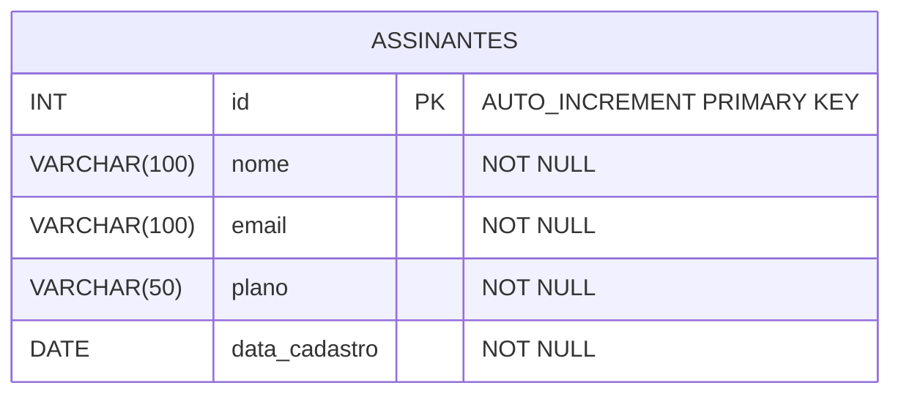
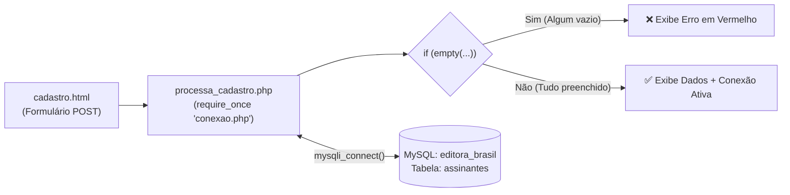

# 📅 Aula 10 (09/11) — Unidades 5 & 6: Estruturas de Controle em PHP e Introdução ao Banco de Dados MySQL

* **Duração:** 3h30m – 4h00m (Teoria Direta + Prática em Laboratório)
* **Projeto Fio Condutor:** Sistema de Vendas de Assinaturas da **EDITORA BR@SIL**

---

## 🎯 Objetivo da Aula
Avançar o Back-End da **Editora Br@sil** aplicando **estruturas de decisão no servidor (`if`, `elseif`, `else` e `empty()`)** para impedir que formulários em branco contaminem o sistema, introduzir os fundamentos de **Banco de Dados Relacional (SGBD MySQL)** criando a base `editora_brasil` e a tabela `assinantes` no **phpMyAdmin**, e construir o módulo reutilizável de conexão **`conexao.php`** usando a biblioteca nativa **`mysqli`**.

---

## 🔄 Evolução Pedagógica: Aula 09 ➔ Aula 10

| Aspecto | Aula 09 (Início do PHP) | Aula 10 (Decisões em PHP + Conexão MySQL) |
| :--- | :--- | :--- |
| **Recebimento do `$_POST`** | Aceitava qualquer envio sem validar no servidor | Valida com **`if (empty($nome) \|\| ...)`** antes de prosseguir |
| **Fluxo do Programa** | Sequencial (apenas `echo` direto) | Condicional (**`if`**, **`elseif`**, **`else`**) com caminhos de Erro vs. Sucesso |
| **Banco de Dados** | Ainda não existia | Criação do banco **`editora_brasil`** e tabela **`assinantes`** no **phpMyAdmin** |
| **Comunicação PHP + MySQL** | Apenas simulada em texto | Conexão real ativa via **`mysqli_connect()`** isolada no `conexao.php` |

---

## 📚 1. Conteúdo Teórico com Exemplos de Código (Para Mostrar em Sala)

> 💡 **Dica para o Professor:** Todos os exemplos abaixo já estão implementados e prontos para rodar ao vivo no arquivo [`Aula10/exemplos.php`](exemplos.php)!

### Tópico 1: Estruturas de Decisão no Servidor (`if`, `elseif`, `else`) e `empty()`

#### 1.1. Tomada de Decisão e Operadores Lógicos/Relacionais
Assim como em C ou JavaScript, o PHP utiliza operadores relacionais (`==`, `!=`, `>`, `<`, `>=`, `<=`) e lógicos (`&&` para **E**, `||` para **OU**, `!` para **NÃO**) para controlar o fluxo da aplicação no servidor:

```php
<?php
// Exemplo prático para mostrar no projetor (presente em Aula10/exemplos.php)
$planoEscolhido = "Plano Digital VIP";
$idadeAssinante = 20;

if ($planoEscolhido == "Revista Semestral") {
    $valorMensalidade = "R$ 59,90";
} elseif ($planoEscolhido == "Revista Anual") {
    $valorMensalidade = "R$ 99,90";
} else {
    $valorMensalidade = "R$ 120,00";
}

// Usando o operador E (&&): ambas as condições precisam ser verdadeiras
if ($idadeAssinante >= 18 && $planoEscolhido == "Plano Digital VIP") {
    echo "Assinatura VIP aprovada imediatamente!";
}
?>
```

#### 1.2. A Função `empty()` e Consistência de Dados
Para testar se uma variável recebida via `$_POST` está vazia ou sem valor preenchido, empregamos **`empty($variavel)`** (ou comparação direta `$variavel == ""`). Combinado com o operador **OU (`||`)**, barramos qualquer envio incompleto:

```php
<?php
// Se o nome OU o e-mail OU o plano estiverem vazios, bloqueia o cadastro!
if (empty($nome) || empty($email) || empty($plano)) {
    echo "Erro: Todos os campos são obrigatórios!";
} else {
    echo "Sucesso: Todos os campos foram preenchidos!";
}
?>
```

---

### Tópico 2: Fundamentos de Banco de Dados Relacional e MySQL

* **O que é o SGBD MySQL?**
  É um **Sistema de Gerenciamento de Banco de Dados** relacional que organiza informações em **tabelas** compostas por **linhas** (registros/tuplas) e **colunas** (campos tipados).
* **Tipos de Dados Essenciais da Nossa Tabela `assinantes`:**
  * **`INT AUTO_INCREMENT PRIMARY KEY`**: Identificador numérico único (`1, 2, 3...`) gerado automaticamente pelo banco para cada novo assinante (Chave Primária).
  * **`VARCHAR(tamanho)`**: Texto de tamanho variável (ex: `VARCHAR(100)` para `nome` e `email`, `VARCHAR(50)` para `plano`).
  * **`DATE`**: Data no formato padrão de banco de dados (`AAAA-MM-DD`).



---

### Tópico 3: Conexão do PHP com o MySQL via `mysqli`

Para abrir comunicação entre o PHP e o MySQL, utilizamos a função nativa **`mysqli_connect()`** passando **4 parâmetros essenciais**:

```php
<?php
$servidor = "localhost";
$usuario  = "root";
$senha    = "root"; // No GitHub Codespaces é "root" (No XAMPP local seria vazia "")
$banco    = "editora_brasil";

$conexao = mysqli_connect($servidor, $usuario, $senha, $banco);

// Tratamento de Falha: se !$conexao (não conectou), interrompe com die() e mostra o erro
if (!$conexao) {
    die("Falha na conexão com o banco de dados: " . mysqli_connect_error());
}
?>
```



---

## 💻 2. Prática em Laboratório Passo a Passo — Laboratório 07

### PASSO 1: Iniciar os Serviços e Acessar o phpMyAdmin

#### No GitHub Codespaces (Em Sala de Aula):
1. Clique na aba **PORTS** (ao lado do Terminal no VS Code).
2. Localize a **Porta `8080` (`phpMyAdmin (Gerenciador do Banco)`)** e clique no ícone do **Globo (Open in Browser)**.
3. Na tela de login do phpMyAdmin, digite:
   * **Utilizador (Usuário):** `root`
   * **Palavra-passe (Senha):** `root`
4. No Terminal do VS Code, inicie o servidor PHP apontando para a `Aula10`:
   ```bash
   php -S 0.0.0.0:8000 -t Aula10
   ```

*(No XAMPP em casa: Inicie **Apache** e **MySQL** no XAMPP Control Panel e acesse `http://localhost/phpmyadmin`).*

---

### PASSO 2: Criar o Banco `editora_brasil` e a Tabela `assinantes`

1. No menu lateral esquerdo do **phpMyAdmin**, clique em **Novo (New)**.
2. No campo **Nome da base de dados**, digite **`editora_brasil`** e clique em **Criar**.
3. Clique na aba superior **SQL**, cole o script abaixo (também disponível em [`Aula10/banco.sql`](banco.sql)) e clique em **Executar (Go)**:

```sql
CREATE TABLE assinantes (
    id INT AUTO_INCREMENT PRIMARY KEY,
    nome VARCHAR(100) NOT NULL,
    email VARCHAR(100) NOT NULL,
    plano VARCHAR(50) NOT NULL,
    data_cadastro DATE NOT NULL
);
```

4. Verifique se a tabela **`assinantes`** apareceu listada no menu esquerdo abaixo do banco **`editora_brasil`**.

---

### PASSO 3: O Script de Conexão ([`conexao.php`](conexao.php))

Isolamos as configurações do banco no arquivo [`Aula10/conexao.php`](conexao.php) para reaproveitá-lo em todas as páginas do sistema:

```php
<?php
// Parâmetros de acesso ao SGBD MySQL
$servidor = "localhost";
$usuario  = "root";
$senha    = "root"; // No GitHub Codespaces a senha padrão é "root" (no XAMPP local seria "")
$banco    = "editora_brasil";

mysqli_report(MYSQLI_REPORT_OFF);

// 1. Criando o link de conexão
$conexao = mysqli_connect($servidor, $usuario, $senha, $banco);

// 2. Verificando se houve erro na tentativa de conexão
if (!$conexao) {
    die("Falha na conexão com o banco de dados: " . mysqli_connect_error());
}

// Configuração opcional para garantir acentuação correta
mysqli_set_charset($conexao, "utf8");
?>
```

* **Teste Rápido:** Abra `/conexao.php` no navegador. Se a página ficar **totalmente em branco**, significa que não caiu no `die()` e a conexão foi bem-sucedida!

---

### PASSO 4: Atualizar o Formulário ([`cadastro.html`](cadastro.html))

Adicionamos o campo `email_assinante` e a primeira opção vazia `<option value="">Selecione um plano...</option>` em [`Aula10/cadastro.html`](cadastro.html) para testar nossa validação condicional.

---

### PASSO 5: Aplicar Validações com `if/else` ([`processa_cadastro.php`](processa_cadastro.php))

Em [`Aula10/processa_cadastro.php`](processa_cadastro.php), incluímos o `conexao.php` e validamos os campos:

```php
<?php
// Inclui o arquivo de conexão criado no Passo 3
require_once "conexao.php";

// Captura dos dados enviados via POST
$nome  = $_POST['nome_assinante'] ?? '';
$email = $_POST['email_assinante'] ?? '';
$plano = $_POST['plano_escolhido'] ?? '';

// Estrutura Condicional: Validando se algum campo ficou em branco no servidor
if (empty($nome) || empty($email) || empty($plano)) {
    echo "<h3 style='color: red;'>Erro: Todos os campos devem ser preenchidos obrigatoriamente!</h3>";
    echo "<p><a href='cadastro.html'>Voltar e preencher novamente</a></p>";
} else {
    // Caso todos os dados estejam corretos:
    echo "<div style='font-family: Arial; border: 1px solid green; padding: 15px; width: 450px;'>";
    echo "<h2 style='color: green;'>Dados Validados com Sucesso!</h2>";
    echo "<p><strong>Assinante:</strong> " . $nome . "</p>";
    echo "<p><strong>E-mail:</strong> " . $email . "</p>";
    echo "<p><strong>Plano:</strong> " . $plano . "</p>";
    echo "<hr>";
    echo "<p style='color: blue;'>Status: Conexão com o banco 'editora_brasil' estabelecida e pronta para o comando INSERT na próxima aula!</p>";
    echo "</div>";
}
?>
```

---

### PASSO 6: Testar e Validar os Cenários

1. **Teste 1 (Validação de Erro):** Deixe o campo de nome vazio (ou não escolha um plano) e clique em `"Avançar para Assinatura"`.
   * *Resultado esperado:* Mensagem vermelha informando que todos os campos são obrigatórios.
2. **Teste 2 (Validação de Sucesso):** Preencha nome, e-mail e selecione um plano.
   * *Resultado esperado:* Caixa verde de confirmação com todos os dados concatenados e o status de conexão ativa com `editora_brasil`.

---

## 🧪 3. Atividade Prática Hands-On para os Alunos (`Atividade10-NomeAlunoRA`)

### 🗂️ Estrutura de Arquivos da Aula 10

```text
Aula10/
├── Aula10.md                        # Ementa oficial das Unidades 5 e 6
├── README.md                        # Este roteiro completo de aula e laboratório
├── exemplos.php                     # Exemplos prontos para o professor demonstrar (if/elseif/else, empty, mysqli)
├── banco.sql                        # Script SQL da tabela 'assinantes' para colar no phpMyAdmin
├── conexao.php                      # Passo 3 do Lab 07 (Conexão mysqli pronta)
├── cadastro.html                    # Passo 4 do Lab 07 (Formulário com Nome, E-mail e Plano)
├── processa_cadastro.php            # Passo 5 do Lab 07 (Validação if/else + empty)
├── estilo.css                       # Folha de estilos da Editora Br@sil
└── Atividade10-NomeAlunoRA/         # Prática individual dos alunos (HTML/CSS prontos, PHP em branco)
    ├── cadastro.html                # Formulário HTML pronto
    ├── estilo.css                   # CSS pronto
    ├── conexao.php                  # Esqueleto para o aluno programar o mysqli_connect()
    └── processa_cadastro.php        # Esqueleto para o aluno programar o if/else e empty()
```

### Instruções para os Alunos:
1. Dupliquem ou renomeiem a pasta `Atividade10-NomeAlunoRA` com seu **Nome e RA**.
2. Para testar a atividade no Codespaces, parem o servidor anterior (`Ctrl + C`) e rodem:
   ```bash
   php -S 0.0.0.0:8000 -t Aula10/Atividade10-NomeAlunoRA
   ```
3. Programem o código PHP nos dois arquivos da atividade:
   * 🟢 **Desafio 1 (`conexao.php`):** Criar as variáveis `$servidor`, `$usuario`, `$senha` e `$banco`, conectar com `mysqli_connect()` e tratar erros com `if (!$conexao) { die(...); }`.
   * 🟡 **Desafio 2 (`processa_cadastro.php`):** Incluir o `conexao.php` com `require_once`, capturar os 3 campos via `$_POST` e validar com `if (empty($nome) || empty($email) || empty($plano))`.
   * 🔴 **Desafio 3 (`processa_cadastro.php`):** Dentro do `else` (quando o formulário é válido), usar uma estrutura `if / elseif / else` para definir e exibir um **Brinde Exclusivo** de acordo com o `$plano` escolhido pelo assinante!
