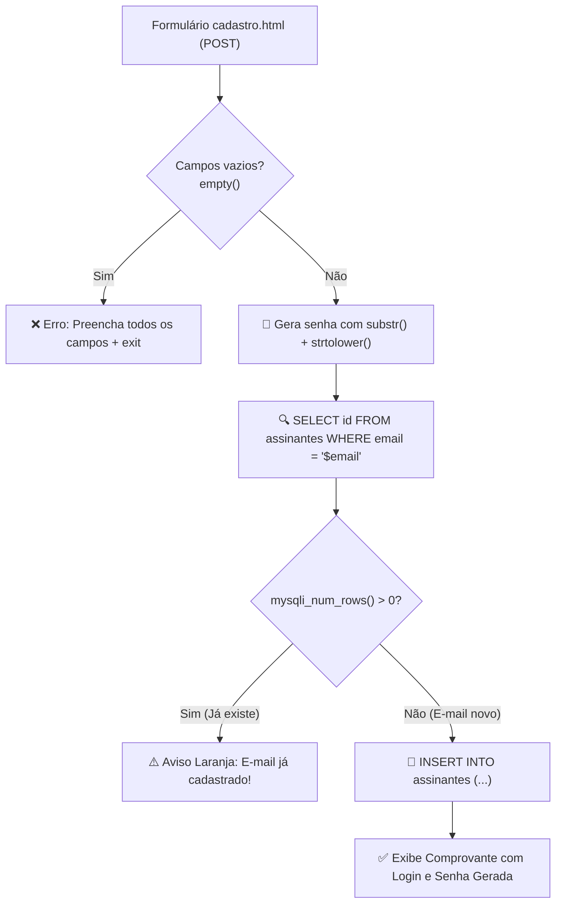

# 📅 Aula 11 (16/11) — Unidade 6: Persistência de Dados no MySQL (`INSERT`) e Geração Automática de Senhas em PHP

* **Duração:** 3h30m – 4h00m (Teoria Direta + Prática em Laboratório)
* **Projeto Fio Condutor:** Sistema de Vendas de Assinaturas da **EDITORA BR@SIL**

---

## 🎯 Objetivo da Aula
Concluir o ciclo de gravação do cadastro da **Editora Br@sil**: evoluir a tabela `assinantes` no **phpMyAdmin** (`ALTER TABLE`) para receber a coluna `senha`, gerar credenciais automáticas em PHP manipulando strings com **`substr()`** e **`strtolower()`**, evitar cadastros duplicados consultando o banco com **`SELECT` + `mysqli_num_rows()`** e gravar permanentemente os assinantes no MySQL com **`INSERT INTO` + `mysqli_query()`**.

---

## 🔄 Evolução Pedagógica: Aula 10 ➔ Aula 11

| Aspecto | Aula 10 (Conexão + Validação `if/else`) | Aula 11 (Persistência Real `INSERT` + Senha) |
| :--- | :--- | :--- |
| **Tabela `assinantes`** | `id`, `nome`, `email`, `plano`, `data_cadastro` | Adição da coluna **`senha VARCHAR(20)`** via `ALTER TABLE` |
| **Geração de Credencial** | Não possuía senha de acesso | Senha gerada automaticamente com **`substr()`** + **`strtolower()`** |
| **E-mails Repetidos** | Não verificava no banco | Bloqueia duplicidade com **`SELECT` + `mysqli_num_rows() > 0`** |
| **Persistência dos Dados** | Apenas exibia na tela (perdia ao fechar) | Gravação definitiva no MySQL com **`INSERT INTO`** e **`mysqli_query()`** |

---

## 📚 1. Conteúdo Teórico com Exemplos de Código (Para Mostrar em Sala)

> 💡 **Dica para o Professor:** Todos os exemplos abaixo já estão prontos para demonstração ao vivo no arquivo [`Aula11/exemplos.php`](exemplos.php)!

### Tópico 1: Manipulação de Strings e Geração Automática de Senha

* **`substr($texto, $inicio, $quantidade)`**: Extrai uma fatia de um texto. A posição `$inicio = 0` indica o primeiro caractere da string.
* **`strtolower($texto)`**: Converte todas as letras da string para **minúsculas**, padronizando a senha gerada.

```php
<?php
// Exemplo prático (disponível em Aula11/exemplos.php):
$nome  = "Maria Silva";
$email = "MARIA@email.com";

// Extrai as 3 primeiras letras do nome ("Mar") e as 3 primeiras do e-mail ("MAR")
$parteNome  = substr($nome, 0, 3);
$parteEmail = substr($email, 0, 3);

// Junta as partes com "26" e converte tudo para minúsculo: resultado -> "marmar26"
$senhaGerada = strtolower($parteNome . $parteEmail . "26");
?>
```

---

### Tópico 2: Inserindo Dados nas Tabelas via PHP (`INSERT INTO` + `mysqli_query`)

Para gravar permanentemente um novo registro no banco de dados MySQL, montamos a instrução SQL **`INSERT INTO`** (lembrando que textos e datas ficam entre **aspas simples `'...'`** dentro do SQL) e a enviamos ao banco com **`mysqli_query($conexao, $sql)`**:

```php
<?php
$dataCadastro = date("Y-m-d"); // Padrão de data do MySQL: AAAA-MM-DD (ex: 2026-11-16)

$sqlInsert = "INSERT INTO assinantes (nome, email, senha, plano, data_cadastro) 
              VALUES ('$nome', '$email', '$senhaGerada', '$plano', '$dataCadastro')";

// mysqli_query retorna true se gravou com sucesso, ou false se houve erro
if (mysqli_query($conexao, $sqlInsert)) {
    echo "Registro gravado com sucesso no MySQL!";
} else {
    echo "Erro ao gravar: " . mysqli_error($conexao);
}
?>
```

---

### Tópico 3: Verificação de Duplicidade (`SELECT` + `mysqli_num_rows`)

Antes de executar o `INSERT`, consultamos o banco para garantir que o e-mail informado ainda não foi cadastrado:

```php
<?php
// 1. Pergunta ao MySQL se já existe algum assinante com este e-mail
$sqlVerifica = "SELECT id FROM assinantes WHERE email = '$email'";
$resultadoVerifica = mysqli_query($conexao, $sqlVerifica);

// 2. Conta quantas linhas o banco encontrou com mysqli_num_rows()
if (mysqli_num_rows($resultadoVerifica) > 0) {
    echo "Atenção: Este e-mail já possui assinatura cadastrada!";
} else {
    // Segue para o INSERT INTO...
}
?>
```



---

## 💻 2. Prática em Laboratório Passo a Passo — Laboratório 08

### PASSO 1: Adicionar a Coluna `senha` na Tabela do MySQL

1. No **GitHub Codespaces**, abra a aba **PORTS** e clique no ícone do **Globo (Open in Browser)** da **Porta `8080` (`phpMyAdmin`)** (Login: `root` / Senha: `root`).
2. Clique no banco de dados **`editora_brasil`** no menu esquerdo, abra a aba **SQL**, cole o comando abaixo (disponível em [`Aula11/banco.sql`](banco.sql)) e clique em **Executar (Go)**:

```sql
ALTER TABLE assinantes ADD senha VARCHAR(20) NOT NULL AFTER email;
```

*(Nota: Caso você tenha reconstruído seu Codespace do zero hoje e o banco `editora_brasil` ainda não exista, copie e cole a **Opção B** do arquivo [`Aula11/banco.sql`](banco.sql) que já cria o banco e a tabela completa com a coluna `senha`!).*

3. No terminal do VS Code, inicie o servidor PHP apontando para a `Aula11`:
   ```bash
   php -S 0.0.0.0:8000 -t Aula11
   ```
4. Abra o navegador na Porta `8000` e clique no topo em **"📚 Ver Exemplos Teóricos"** ([`exemplos.php`](exemplos.php)) para confirmar no Bloco 3 que a coluna `senha` foi detectada com sucesso!

---

### PASSO 2: Implementar a Gravação e Geração de Senha ([`processa_cadastro.php`](processa_cadastro.php))

Confira o código completo em [`Aula11/processa_cadastro.php`](processa_cadastro.php):

```php
<?php
// 1. Reutiliza o arquivo de conexão com o banco 'editora_brasil'
require_once "conexao.php";

// 2. Recebe os dados enviados pelo formulário cadastro.html via POST
$nome  = $_POST['nome_assinante'] ?? '';
$email = $_POST['email_assinante'] ?? '';
$plano = $_POST['plano_escolhido'] ?? '';
$dataCadastro = date("Y-m-d"); // Formato padrão de data do MySQL (AAAA-MM-DD)

// 3. Validação básica de campos vazios
if (empty($nome) || empty($email) || empty($plano)) {
    echo "<h3 style='color: red;'>Erro: Preencha todos os campos obrigatórios!</h3>";
    echo "<a href='cadastro.html'>Voltar ao formulário</a>";
    exit; // Interrompe a execução do script
}

// 4. Geração automática de senha (3 primeiras letras do nome + 3 do e-mail + "26")
$parteNome   = substr($nome, 0, 3);
$parteEmail  = substr($email, 0, 3);
$senhaGerada = strtolower($parteNome . $parteEmail . "26"); // Converte tudo para minúsculo

// 5. Verifica se o e-mail já está cadastrado no banco
$sqlVerifica = "SELECT id FROM assinantes WHERE email = '$email'";
$resultadoVerifica = mysqli_query($conexao, $sqlVerifica);

if (mysqli_num_rows($resultadoVerifica) > 0) {
    echo "<h3 style='color: orange;'>Atenção: Este e-mail já possui assinatura cadastrada!</h3>";
    echo "<a href='cadastro.html'>Tentar com outro e-mail</a>";
} else {
    // 6. Comando SQL para inserir os dados na tabela 'assinantes'
    $sqlInsert = "INSERT INTO assinantes (nome, email, senha, plano, data_cadastro) 
                  VALUES ('$nome', '$email', '$senhaGerada', '$plano', '$dataCadastro')";

    // Executa o INSERT e verifica se funcionou
    if (mysqli_query($conexao, $sqlInsert)) {
        ?>
        <!DOCTYPE html>
        <html lang="pt-br">
        <head>
            <meta charset="UTF-8">
            <title>Comprovante de Assinatura</title>
        </head>
        <body style="font-family: Arial, sans-serif; background-color: #f4f4f4; padding: 20px;">
            <div style="background-color: #fff; border: 2px solid #000080; padding: 20px; max-width: 520px; margin: 0 auto;">
                <h2 style="color: #000080; margin-top: 0;">Assinatura Concluída com Sucesso!</h2>
                <p>Bem-vindo(a) à <strong>Editora Br@sil</strong>, <?php echo $nome; ?>!</p>
                <hr>
                <p><strong>Plano Adquirido:</strong> <?php echo $plano; ?></p>
                <p><strong>Seu Login de Acesso:</strong> <?php echo $email; ?></p>
                <p><strong>Sua Senha Gerada:</strong> <span style="background: #ffffcc; padding: 3px 8px; font-weight: bold;"><?php echo $senhaGerada; ?></span></p>
                <hr>
                <p style="font-size: 13px; color: #555;">Guarde sua senha para acessar a área restrita do assinante na próxima aula.</p>
                <a href="cadastro.html">Realizar novo cadastro</a>
            </div>
        </body>
        </html>
        <?php
    } else {
        echo "<h3 style='color: red;'>Erro ao gravar no banco de dados: " . mysqli_error($conexao) . "</h3>";
    }
}

// Fecha a conexão com o MySQL
mysqli_close($conexao);
?>
```

---

### PASSO 3: Testar a Persistência Real ("A Prova dos Nove")

1. Preencha o formulário com `Maria Silva`, `maria@email.com` e `Revista Anual`, clicando em **Avançar para Assinatura**.
2. **Verifique na Tela:** Apareceu a caixa azul com o comprovante e a senha gerada em minúsculo (`marmar26`)?
3. **Verifique no Banco de Dados (phpMyAdmin - Porta 8080):** Clique na tabela `assinantes` ➔ aba **Visualizar (Browse)** e comprove que o registro está salvo lá dentro com `id = 1`!
4. **Teste de Duplicidade:** Volte no formulário e tente cadastrar `maria@email.com` novamente. O sistema deve bloquear e exibir o aviso laranja!

---

## 🧪 3. Atividade Prática Hands-On para os Alunos (`Atividade11-NomeAlunoRA`)

### 🗂️ Estrutura de Arquivos da Aula 11

```text
Aula11/
├── Aula11.md                        # Ementa oficial da Unidade 6 (Laboratório 08)
├── README.md                        # Este roteiro completo de aula e laboratório
├── exemplos.php                     # Exemplos prontos para o professor demonstrar em sala
├── banco.sql                        # Comandos SQL (ALTER TABLE / CREATE TABLE) para o phpMyAdmin
├── conexao.php                      # Conexão mysqli pronta
├── cadastro.html                    # Formulário da Editora Br@sil
├── processa_cadastro.php            # Código completo do Laboratório 08 (Demonstração do Professor)
├── estilo.css                       # Folha de estilos da Editora Br@sil
└── Atividade11-NomeAlunoRA/         # Prática individual dos alunos (HTML/CSS/Conexão prontos; PHP em branco)
    ├── cadastro.html                # Formulário HTML pronto
    ├── conexao.php                  # Conexão pronta
    ├── estilo.css                   # CSS pronto
    └── processa_cadastro.php        # Esqueleto comentado para o aluno programar a senha, o SELECT e o INSERT
```

### Instruções para os Alunos:
1. Dupliquem ou renomeiem a pasta `Atividade11-NomeAlunoRA` com seu **Nome e RA**.
2. No terminal do Codespaces, parem o servidor anterior (`Ctrl + C`) e iniciem apontando para a pasta da atividade:
   ```bash
   php -S 0.0.0.0:8000 -t Aula11/Atividade11-NomeAlunoRA
   ```
3. Programem os 3 desafios dentro de [`Atividade11-NomeAlunoRA/processa_cadastro.php`](Atividade11-NomeAlunoRA/processa_cadastro.php):
   * 🟢 **Desafio 1 (Geração de Senha):** Usar `substr($nome, 0, 3)` e `substr($email, 0, 3)` combinados com `strtolower()` para gerar a `$senhaGerada`.
   * 🟡 **Desafio 2 (Verificação de Duplicidade):** Executar `SELECT id FROM assinantes WHERE email = '$email'` e usar `mysqli_num_rows()` para barrar e-mails repetidos.
   * 🔴 **Desafio 3 (Persistência `INSERT INTO`):** Gravar o novo assinante na tabela `assinantes` com `mysqli_query()` e exibir o comprovante com o login e a senha gerada!
