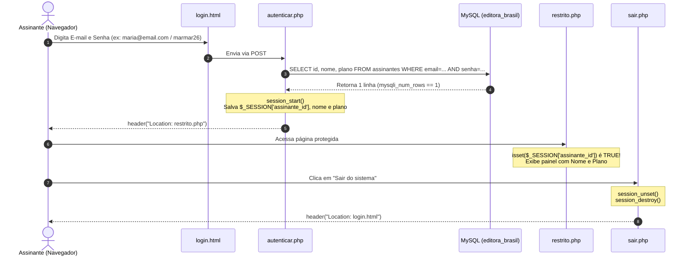

# 📅 Aula 12 (23/11) — Unidade 6: Recuperação de Dados (`SELECT`), Variáveis de Sessão (`$_SESSION`) e Área Restrita do Assinante

* **Duração:** 3h30m – 4h00m (Teoria Direta + Prática em Laboratório)
* **Projeto Fio Condutor:** Sistema de Vendas de Assinaturas da **EDITORA BR@SIL**

---

## 🎯 Objetivo da Aula
Fechar o ciclo completo de autenticação e leitura de dados da **Editora Br@sil**: construir o relatório dinâmico de assinantes cadastrados no MySQL com **`SELECT` + `while` + `mysqli_fetch_assoc()`**, autenticar o e-mail e a senha gerada na aula anterior (`autenticar.php`), manter o assinante logado entre páginas usando **Variáveis de Sessão (`session_start()`, `$_SESSION`)**, proteger o **Espaço Restrito aos Assinantes (`restrito.php`)** contra acessos não autorizados via **`header("Location: ...")`** e implementar o encerramento seguro de sessão (**`session_destroy()`** em `sair.php`).

---

## 🔄 Evolução Pedagógica: Aula 11 ➔ Aula 12

| Aspecto | Aula 11 (Persistência `INSERT` + Senha) | Aula 12 (`SELECT`, Login, `$_SESSION` e Área Restrita) |
| :--- | :--- | :--- |
| **Operação no Banco MySQL** | Gravação (`INSERT INTO`) | Leitura de listas (`SELECT ... ORDER BY`) e autenticação (`WHERE email=... AND senha=...`) |
| **Leitura de Linhas no PHP** | Apenas contava linhas (`mysqli_num_rows`) | Percorre e extrai os dados de cada coluna com **`while ($linha = mysqli_fetch_assoc($resultado))`** |
| **Memória entre Páginas** | Sem estado (cada página esquecia o usuário) | Persistência de login no servidor com **`session_start()`** e **`$_SESSION`** |
| **Controle de Acesso** | Todas as páginas eram públicas | Proteção de rota com **`if (!isset($_SESSION['assinante_id']))`** e **`header("Location: ...")`** |

---

## 📚 1. Conteúdo Teórico com Exemplos de Código (Para Mostrar em Sala)

> 💡 **Dica para o Professor:** Abra o arquivo [`Aula12/exemplos.php`](exemplos.php) no navegador para demonstrar os 3 tópicos abaixo funcionando ao vivo (incluindo um **Monitor em Tempo Real da `$_SESSION`** que muda de estado quando você faz login ou logout!).

### Tópico 1: Recuperação de Dados do MySQL (`SELECT`, `while` e `mysqli_fetch_assoc`)

Quando uma consulta `SELECT` retorna várias linhas, combinamos um laço **`while`** com a função **`mysqli_fetch_assoc($resultado)`**. A cada volta do laço, uma linha da tabela é transformada em um array associativo (`$linha['nome']`, `$linha['plano']`):

```php
<?php
$sql = "SELECT id, nome, email, plano, data_cadastro FROM assinantes ORDER BY nome ASC";
$resultado = mysqli_query($conexao, $sql);

while ($linha = mysqli_fetch_assoc($resultado)) {
    echo "<tr>";
    echo "<td>" . $linha['id'] . "</td>";
    echo "<td>" . $linha['nome'] . "</td>";
    echo "<td>" . $linha['email'] . "</td>";
    echo "<td>" . $linha['plano'] . "</td>";
    echo "<td>" . $linha['data_cadastro'] . "</td>";
    echo "</tr>";
}
?>
```

---

### Tópico 2: Variáveis de Sessão (`$_SESSION`) e Ciclo de Vida

Como o protocolo HTTP não guarda memória entre uma página e outra, o PHP utiliza sessões no servidor:

1. **Iniciar (`session_start();`):** Deve ser sempre a **primeira instrução** no topo do arquivo `.php` antes de qualquer HTML.
2. **Gravar / Ler (`$_SESSION['chave']`):**
   ```php
   $_SESSION['assinante_id']    = $assinante['id'];
   $_SESSION['assinante_nome']  = $assinante['nome'];
   $_SESSION['assinante_plano'] = $assinante['plano'];
   ```
3. **Destruir (`session_unset(); session_destroy();`):** Apaga os dados da sessão quando o assinante clica em **"Sair"** (`sair.php`).

---

### Tópico 3: Redirecionamento e Proteção de Páginas (`header`)

A função **`header("Location: pagina.php");`** seguida de **`exit;`** redireciona o navegador automaticamente:

```php
<?php
session_start();

// PROTEÇÃO DE PÁGINA: Se NÃO existir sessão ativa, expulsa para o login!
if (!isset($_SESSION['assinante_id'])) {
    header("Location: login.html");
    exit;
}
?>
```



---

## 💻 2. Prática em Laboratório Passo a Passo — Laboratório 09

### Preparação Rápida no GitHub Codespaces:
1. *(Caso seu Codespace tenha sido recriado hoje)*: Abra o **phpMyAdmin na Porta 8080** (`root` / `root`) e execute o script [`Aula12/banco.sql`](banco.sql) na aba SQL — ele garante a criação do banco `editora_brasil`, da tabela `assinantes` com a coluna `senha` e já cadastra a cliente de teste **Maria Silva** (`maria@email.com` | senha: **`marmar26`**).
2. No terminal do VS Code, inicie o servidor PHP apontando para a `Aula12`:
   ```bash
   php -S 0.0.0.0:8000 -t Aula12
   ```

---

### PASSO 1: Criar a Listagem de Assinantes ([`listar_assinantes.php`](listar_assinantes.php))
Consulta o banco `editora_brasil` e exibe todos os clientes cadastrados em uma tabela HTML usando `while ($linha = mysqli_fetch_assoc($resultado))`.

### PASSO 2: Criar o Formulário de Login ([`login.html`](login.html))
Formulário HTML que envia `email_login` e `senha_login` via `method="POST"` para `autenticar.php`.

### PASSO 3: Autenticar e Criar a Sessão ([`autenticar.php`](autenticar.php))
Conferimos se `mysqli_num_rows($resultado) == 1`. Se positivo, gravamos os dados em `$_SESSION` e redirecionamos com `header("Location: restrito.php")`.

### PASSO 4: Criar a Página Protegida ([`restrito.php`](restrito.php)) e o Logout ([`sair.php`](sair.php))
* Em [`restrito.php`](restrito.php), verificamos no topo `if (!isset($_SESSION['assinante_id']))` para expulsar visitantes não logados.
* Em [`sair.php`](sair.php), executamos `session_unset()` e `session_destroy()` antes de redirecionar de volta para `login.html`.

### PASSO 5: Testar o Fluxo Completo de Autenticação
1. **Teste de Bloqueio (Segurança):** Tente abrir diretamente `/restrito.php` sem fazer login. O sistema redirecionará você automaticamente para `login.html`.
2. **Teste de Login:** Em `login.html`, digite `maria@email.com` e a senha `marmar26` (ou cadastre um novo assinante em `cadastro.html`) e clique em **Entrar no Sistema**. Você verá o painel vermelho do **Espaço Restrito aos Assinantes** exibindo seu nome e plano!
3. **Teste de Logout:** Clique em **"clique aqui"** no canto superior direito para acionar o `sair.php` e destruir a sessão.

---

## 🧪 3. Atividade Prática Hands-On para os Alunos (`Atividade12-NomeAlunoRA`)

### 🗂️ Estrutura de Arquivos da Aula 12

```text
Aula12/
├── Aula12.md                        # Ementa oficial da Unidade 6 (Laboratório 09)
├── README.md                        # Este roteiro completo de aula e laboratório
├── exemplos.php                     # Exemplos interativos + Monitor ao vivo de $_SESSION para o professor
├── banco.sql                        # Criação da tabela + Assinante de teste (maria@email.com / marmar26)
├── conexao.php                      # Conexão mysqli pronta
├── listar_assinantes.php            # Passo 1 do Lab 09 (Relatório com SELECT + while)
├── login.html                       # Passo 2 do Lab 09 (Tela de Login)
├── autenticar.php                   # Passo 3 do Lab 09 (Autenticação + Criação da $_SESSION)
├── restrito.php                     # Passo 4 do Lab 09 (Espaço Restrito protegido)
├── sair.php                         # Passo 4 do Lab 09 (Logout com session_destroy)
├── cadastro.html                    # Formulário de nova assinatura integrado
├── processa_cadastro.php            # Gravação de nova assinatura integrada
├── estilo.css                       # Folha de estilos da Editora Br@sil
└── Atividade12-NomeAlunoRA/         # Prática individual dos alunos (HTML/Conexão prontos; PHP em branco)
    ├── conexao.php                  # Conexão pronta
    ├── login.html                   # Formulário de Login pronto
    ├── listar_assinantes.php        # Desafio 1: Programar o SELECT e o laço while
    ├── autenticar.php               # Desafio 2: Programar a autenticação e gravar $_SESSION
    ├── restrito.php                 # Desafio 3: Programar a proteção !isset($_SESSION) e exibir dados
    └── sair.php                     # Desafio 3: Programar o session_destroy()
```

### Instruções para os Alunos:
1. Dupliquem ou renomeiem a pasta `Atividade12-NomeAlunoRA` com seu **Nome e RA**.
2. Para testar a atividade no terminal do Codespaces, parem o servidor anterior (`Ctrl + C`) e rodem:
   ```bash
   php -S 0.0.0.0:8000 -t Aula12/Atividade12-NomeAlunoRA
   ```
3. Completem os 3 Desafios em PHP:
   * 🟢 **Desafio 1 (`listar_assinantes.php`):** Consultar a tabela `assinantes` com `SELECT` e desenhar as linhas da tabela HTML usando `while ($linha = mysqli_fetch_assoc($resultado))`.
   * 🟡 **Desafio 2 (`autenticar.php`):** Iniciar a sessão com `session_start()`, validar e-mail e senha no MySQL, salvar `assinante_id`, `assinante_nome` e `assinante_plano` em `$_SESSION` e redirecionar para `restrito.php`.
   * 🔴 **Desafio 3 (`restrito.php` e `sair.php`):** Proteger `restrito.php` com `if (!isset($_SESSION['assinante_id']))`, exibir o nome e plano do assinante logado e implementar o logout em `sair.php` com `session_destroy()`.
