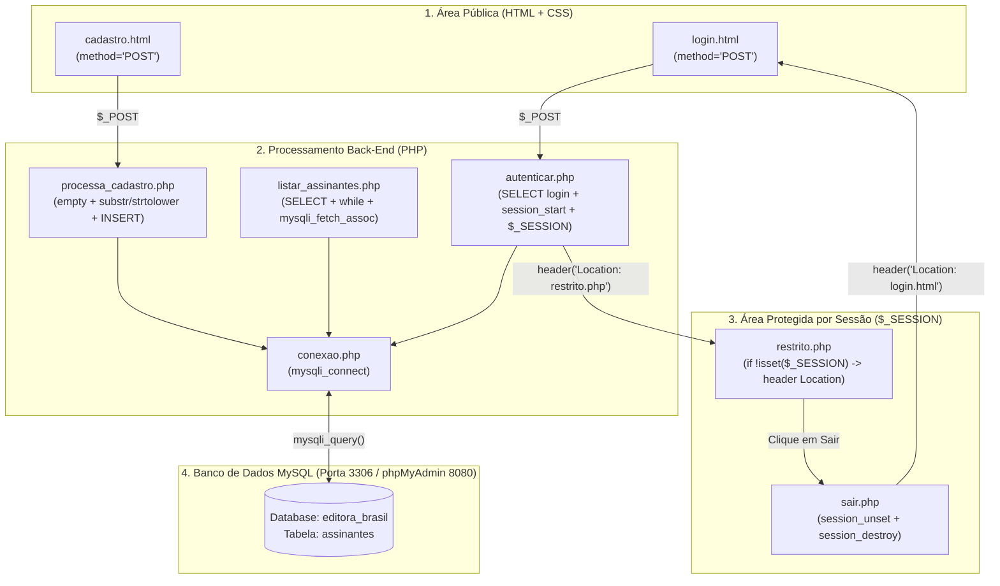

# 📅 Aula 13 (30/11) — Fechamento do Semestre: Revisão Intensiva de PHP & MySQL e Homologação do Projeto

* **Duração:** 3h30m – 4h00m (Revisão Conceitual + Simulado Dissertativo + Validação em Bancada)
* **Projeto Fio Condutor:** Sistema de Vendas de Assinaturas da **EDITORA BR@SIL (Ciclo Completo)**

---

## 🎯 Objetivo da Aula
Consolidar todo o aprendizado prático das **Unidades 5 e 6 (PHP & MySQL)** preparando a turma para a **Prova Bimestral (07 a 10/12)** por meio de um Guia Rápido de Revisão e uma **Bateria de Treino com 8 Questões Dissertativas**, e realizar na segunda metade da aula a **Homologação Final em Bancada** dos 5 requisitos integrados do projeto da **Editora Br@sil** (estruturado na pasta [`Projeto Completo/`](../Projeto%20Completo/)).

---

## 🗺️ Visão Geral da Arquitetura Completa (Editora Br@sil)



---

## 📚 Parte 1: Guia Rápido de Revisão (19h15 – 20h00)

Para projetar os exemplos de código ao vivo no navegador durante a revisão, inicie o servidor na pasta `Aula13`:
```bash
php -S 0.0.0.0:8000 -t Aula13
```
E abra **`/exemplos_revisao.php`** ([`Aula13/exemplos_revisao.php`](exemplos_revisao.php)).

| Tópico da Prova | Comandos e Conceitos Essenciais que o Aluno Precisa Dominar |
| :--- | :--- |
| **1. Server-Side e Sintaxe** | O navegador não interpreta `.php` com dois cliques (exige Apache / PHP Server). Delimitadores `<?php ?>`, variáveis com `$`, ponto e vírgula `;`, concatenação com ponto `.` e saída com `echo`. |
| **2. Formulários e Strings** | `$_POST['name']` (dados ocultos no corpo HTTP) vs `$_GET['param']` (visível na URL). Validação com `if (empty($var))`. Senha automática com `substr($txt, 0, 3)` e `strtolower()`. |
| **3. PHP + MySQL (CRUD)** | `$conexao = mysqli_connect("localhost", "root", "root", "editora_brasil");` e `mysqli_query($conexao, $sql);`. Comandos SQL: `INSERT INTO`, `SELECT ... WHERE ... ORDER BY`, `UPDATE ... SET`, `DELETE FROM`. Leitura com `while ($linha = mysqli_fetch_assoc($res))` e contagem com `mysqli_num_rows($res)`. |
| **4. Sessões e Segurança** | HTTP não guarda estado. `session_start()` no topo; gravação em `$_SESSION['chave']`; proteção com `if (!isset($_SESSION['assinante_id'])) { header("Location: login.html"); exit; }` e logout com `session_unset()` + `session_destroy()`. |

---

## 📝 Parte 2: Bateria de Treino para a Prova Bimestral (20h00 – 21h00)

1. Os alunos devem abrir o arquivo [`Aula13/Atividade13-NomeAlunoRA/Simulado_Prova_Bimestral.md`](Atividade13-NomeAlunoRA/Simulado_Prova_Bimestral.md) (que contém apenas as 8 perguntas dissertativas sem o gabarito) e redigir suas respostas.
2. Ao final do tempo, utilize o gabarito oficial documentado em [`Aula13/Aula13.md`](Aula13.md) para corrigir e debater cada questão com a turma.

---

## ✅ Parte 3: Homologação Final em Bancada — [`Projeto Completo/`](../Projeto%20Completo/) (21h00 – 22h00)

Toda a implementação de referência exigida no **Item 3 (Checklist de Homologação Final em Bancada)** foi estruturada na pasta **[`Projeto Completo/`](../Projeto%20Completo/)**.

Para rodar e homologar o **Projeto Completo** no GitHub Codespaces:
```bash
php -S 0.0.0.0:8000 -t "Projeto Completo"
```

### Os 5 Requisitos Verificados na Homologação (e pelo Validador Automático [`homologacao.php`](../Projeto%20Completo/homologacao.php)):

- [x] **1. Interface e Estrutura:** [`cadastro.html`](../Projeto%20Completo/cadastro.html) e [`login.html`](../Projeto%20Completo/login.html) estruturados e navegáveis a partir do portal [`index.html`](../Projeto%20Completo/index.html).
- [x] **2. Conexão Ativa:** [`conexao.php`](../Projeto%20Completo/conexao.php) conectando sem erros ao banco `editora_brasil` no MySQL.
- [x] **3. Gravação e Senha Automática:** [`processa_cadastro.php`](../Projeto%20Completo/processa_cadastro.php) gerando senha com `substr()`/`strtolower()`, bloqueando e-mail duplicado e salvando via `INSERT INTO`.
- [x] **4. Listagem Dinâmica:** [`listar_assinantes.php`](../Projeto%20Completo/listar_assinantes.php) recuperando os registros com `SELECT` e exibindo em tabela HTML com laço `while`.
- [x] **5. Autenticação e Sessão:** [`autenticar.php`](../Projeto%20Completo/autenticar.php), [`restrito.php`](../Projeto%20Completo/restrito.php) e [`sair.php`](../Projeto%20Completo/sair.php) validando login, mantendo `$_SESSION`, bloqueando acesso direto via `header()` e encerrando com `session_destroy()`.
